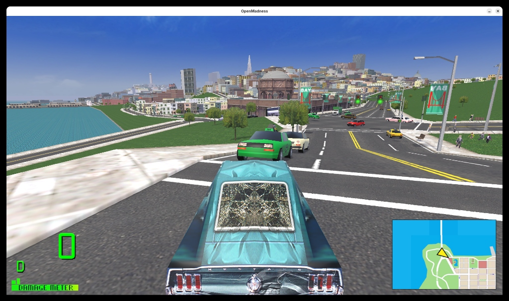
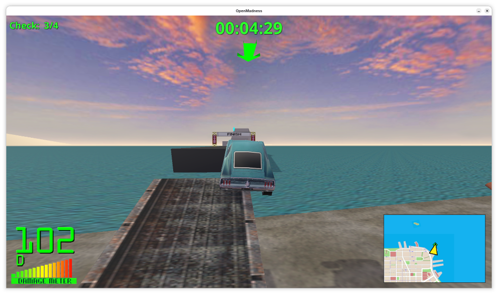
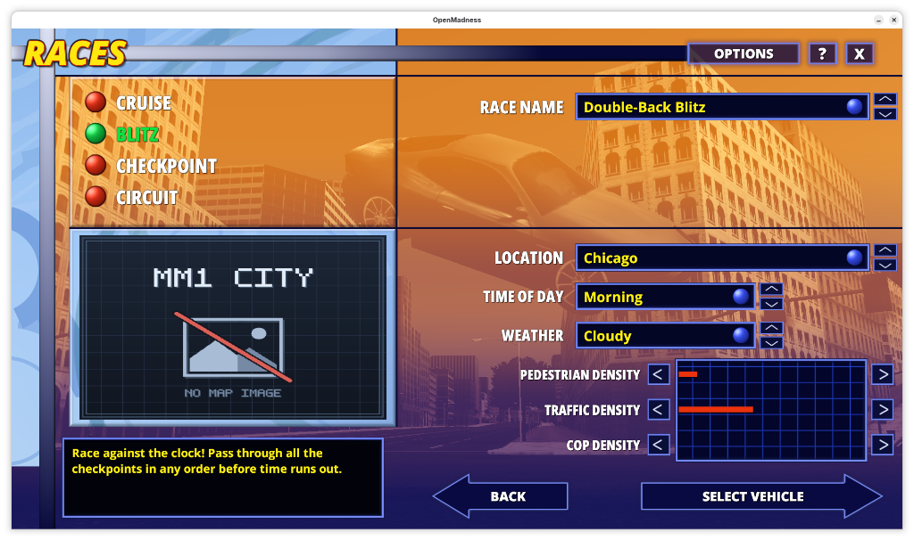

# Open Madness

**Open Madness** is an unofficial, open-source game engine reimplementation built with Unity that reads cities, vehicles, races, missions, audio, and textures directly from *Midtown Madness 1*, *Midtown Madness 2*, and community mod `.ar` archive files at runtime.

> **Legal Disclaimer:** Open Madness is an independent, clean-room community project. It is **not** affiliated with, endorsed by, or sponsored by Microsoft Corporation, Rockstar San Diego (formerly Angel Studios), or any vehicle manufacturers. **No original game assets (`.ar` files, 3D models, textures, or audio) are included in this repository or in binary distributions.** You must supply the `.ar` archive files from your own legally owned copy of the original game(s).

---

## Screenshots

---

## Getting Started (Bring Your Own `.ar` Archives)

1. Place your legally owned `.ar` archive files into the `resources/` folder next to `OpenMadness.exe` / `OpenMadness.x86_64` (or `<ProjectRoot>/resources/` when running inside the Unity Editor):
   * **Midtown Madness 2 archives:** `mm2core.ar`, `mm2tex.ar`, `mm2aud.ar`, `mm2audex.ar`, etc.
   * **Midtown Madness 1 archives:** `core.ar`, `ui.ar`, `audio.ar`, etc.
   * **Community mod `.ar` archives:** Custom cities, vehicles, and race packs (supports `DAVE`, `ARES`, standard `PKZIP`, and AR-locked `PKZIP` `.ar` archives).
2. *(Optional)* Copy your `players/` directory from *Midtown Madness 2* into `resources/players/` to import existing driver profiles and progress (*Midtown Madness 1* savegames are not supported). If no `players/` directory is found, an Amateur `DriverX` profile will be created automatically inside `resources/players/`.
3. Launch `OpenMadness.exe` (Windows) or `OpenMadness.x86_64` (Linux). Display and menu settings are persisted to `settings.json`.

---

## Features

* **Direct `.ar` Virtual File System:** Reads `.psdl` & `.ptl` city geometry, `.pkg` & `.bms` vehicle/prop meshes, `.tex` / `.tga` / `.dds` / `.bmp` / `.jpg` textures, `.inst` props, `.bai` AI road networks, and `.wav` audio directly from `.ar` archives in memory.
* **Dynamic City, Race & Vehicle Discovery:** Automatically discovers all available cities, race modes (Cruise, Blitz, Checkpoint, Circuit, and Crash Course where present), and vehicles from mounted `.ar` archives with graceful fallbacks if any specific archive or asset is absent.
* **Compatible Save & Record Files:** Reads and writes binary `players.dir`, `playerN.sav`, `<city>/playerN.rec`, `<city>/amateur.dat`, and `<city>/pro.dat` files inside `resources/players/`.

---

## Controls

| Action | Primary Key(s) | Alternate Key(s) |
| :--- | :--- | :--- |
| **Throttle / Brake & Reverse** | `Up` / `Down` Arrows | `W` / `S` |
| **Steer Left / Right** | `Left` / `Right` Arrows | `A` / `D` |
| **Handbrake** | `Spacebar` | — |
| **Horn / Police Siren** | `H` | — |
| **Toggle Headlights** | `L` | — |
| **Cycle Camera View** | `C` | — |
| **Toggle HUD / Minimap** | `Tab` / `M` | — |
| **Pause / Return to Menu** | `Escape` | — |

---

## Third-Party Open Source Notices

* **Open Sans Font Family (v3.003):** Copyright 2020 The Open Sans Project Authors (`https://github.com/googlefonts/opensans`), licensed under the **SIL Open Font License, Version 1.1** (`Assets/Resources/Fonts/OFL.txt` and `THIRD_PARTY_NOTICES.md`).
